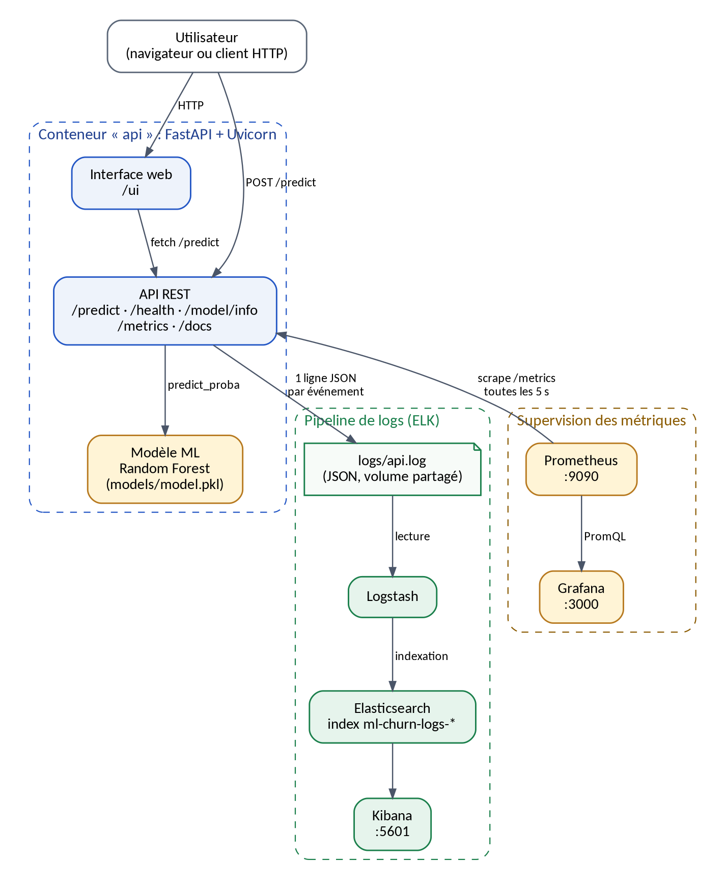

# ML Churn - Prédiction du départ client, industrialisée

Projet fil rouge du cours *Industrialisation du développement* : un modèle de Machine Learning
qui prédit le risque de départ (churn) d'un client d'un opérateur télécom, exposé par une API,
testé automatiquement, conteneurisé, intégré en continu et supervisé.

| Brique | Technologie |
|---|---|
| Modèle | scikit-learn (Random Forest, 200 arbres) |
| API | FastAPI + Uvicorn, validation Pydantic |
| Interface | page HTML servie par l'API (`/ui/`) |
| Tests | Pytest (unitaires / API), Selenium (E2E), JMeter (charge) |
| Conteneurs | Docker, Docker Compose |
| CI | GitHub Actions |
| Logs | JSON structuré -> Logstash -> Elasticsearch -> Kibana |
| Métriques | prometheus-fastapi-instrumentator -> Prometheus -> Grafana |



## 1. Structure du projet

```
ml-churn-project/
├── api/                    API FastAPI (main.py) et configuration des logs JSON
├── src/                    generate_data.py (dataset) et train.py (entraînement)
├── notebooks/              exploration.py, model_comparison.py (validation croisée)
├── data/raw/churn.csv      dataset synthétique de 2 000 clients
├── models/                 model.pkl (modèle) et metadata.json (traçabilité)
├── frontend/               interface web de démonstration
├── tests/                  tests Pytest, test Selenium, tests/load (JMeter + générateur Python)
├── monitoring/             Prometheus et Grafana (datasource et dashboard provisionnés)
├── docker/logstash/        pipeline Logstash
├── scripts/                smoke_test.sh, run_load_tests.sh
├── docs/                   schémas d'architecture et résultats des tests de charge
├── Dockerfile  docker-compose.yml  pytest.ini  requirements.txt
└── .github/workflows/ci.yml
```

## 2. Prérequis

- Python **3.12** (le `requirements.txt` est gelé sous 3.12 : NumPy 2.5 et SciPy 1.18 exigent Python >= 3.12)
- Git
- Docker et Docker Compose v2 (pour la partie conteneurs, au moins 4 Go de RAM pour la stack complète)
- Google Chrome (uniquement pour les tests Selenium)
- Apache JMeter 5.x (uniquement pour rejouer le plan de charge `.jmx`)

## 3. Installation locale

```bash
git clone <URL_DU_DEPOT> ml-churn-project && cd ml-churn-project
python3 -m venv .venv
source .venv/bin/activate            # Windows : .venv\Scripts\activate
pip install --upgrade pip
pip install -r requirements.txt
```

## 4. Données et modèle

```bash
python src/generate_data.py          # crée data/raw/churn.csv
MPLBACKEND=Agg python notebooks/exploration.py   # statistiques + graphiques (sans écran)
python src/train.py                  # compare 3 modèles, sauvegarde models/model.pkl et metadata.json
python notebooks/model_comparison.py # validation croisée + plafond théorique du dataset
```

Le dépôt contient déjà `data/raw/churn.csv` et `models/model.pkl` : l'API démarre sans réentraîner.

## 5. Lancer l'API

```bash
uvicorn api.main:app --reload        # http://127.0.0.1:8000
```

| Méthode | Route | Rôle |
|---|---|---|
| GET | `/` | informations générales |
| GET | `/health` | état de santé (`{"status": "UP"}`) |
| GET | `/model/info` | modèle, version, variables, métriques d'entraînement |
| POST | `/predict` | prédiction de churn |
| GET | `/metrics` | métriques Prometheus |
| GET | `/docs` | documentation Swagger interactive |
| GET | `/ui/` | interface web |

```bash
curl -X POST http://127.0.0.1:8000/predict -H "Content-Type: application/json" -d '{
  "age": 35, "anciennete": 5, "revenu": 450000,
  "nb_reclamations": 2, "montant_mensuel": 25000, "retards_paiement": 2 }'
```

Les entrées sont bornées (âge 18-120, ancienneté <= 1200 mois, etc.) : une valeur hors bornes, `NaN` ou
`Infinity` renvoie une erreur **422** propre.

## 6. Tests

```bash
pytest                               # 16 tests API (les tests e2e sont exclus par défaut)
pytest -m e2e tests/test_selenium.py # tests Selenium : l'API doit tourner sur localhost:8000
```

Variables utiles pour Selenium : `BASE_URL`, `CHROME_BINARY`, `CHROMEDRIVER_PATH`, `SCREENSHOT_DIR`.

## 7. Docker

```bash
docker build -t ml-churn-api .
docker run -p 8000:8000 ml-churn-api          # API seule
```

### Stack complète (API + observabilité)

```bash
# Linux uniquement, requis par Elasticsearch :
sudo sysctl -w vm.max_map_count=262144

docker compose build
docker compose up -d
docker compose ps
```

Version légère, sans ELK : `docker compose up -d api prometheus grafana`.

| Service | URL | Identifiants |
|---|---|---|
| API | http://localhost:8000 (`/docs`, `/ui/`) | - |
| Prometheus | http://localhost:9090 | - |
| Grafana | http://localhost:3000 | admin / admin (à changer) |
| Kibana | http://localhost:5601 | - |
| Elasticsearch | http://localhost:9200 | sécurité désactivée (TP uniquement) |

## 8. Observabilité

**Logs (ELK).** L'API écrit une ligne JSON par événement dans `logs/api.log` (volume partagé avec
Logstash). Champs : `timestamp`, `level`, `event`, `operation`, `request_id`, `client_ip`,
`model`, `model_version`, `prediction`, `probability`, `response_time_ms`, `error_type`, `error`.
Dans Kibana : *Stack Management > Data Views > Create data view*, motif `ml-churn-logs-*`,
champ de temps `@timestamp`, puis *Discover*. Recherches utiles (KQL) :
`event:prediction`, `level:ERROR`, `model_version:"1.0.0"`, `response_time_ms > 100`.

**Métriques (Prometheus + Grafana).** Prometheus collecte `/metrics` toutes les 5 s. Le dashboard
*ML Churn - API de prédiction* (dossier *ML Churn*) est provisionné automatiquement : volumétrie,
taux d'erreur, latence p50/p95/p99, durée d'inférence, prédictions par classe, probabilité
moyenne prédite (indicateur de dérive), erreurs par type.

## 9. Tests de charge

Avec JMeter (le plan est paramétrable) :

```bash
jmeter -n -t tests/load/churn_load_test.jmx -Jthreads=100 -Jrampup=10 -Jloops=10 \
       -l results/jmeter_100.jtl -e -o results/jmeter_report_100
```

Répéter avec `-Jthreads=500` puis `-Jthreads=1000` (le dossier `-o` ne doit pas déjà exister).
Sans JMeter, le générateur Python reproduit le même scénario :

```bash
./scripts/run_load_tests.sh          # 100 / 500 / 1000 utilisateurs -> results/load_<N>.json
```

Les mesures réalisées lors de la rédaction du projet sont dans `docs/performance/`.

## 10. Intégration continue

`.github/workflows/ci.yml` s'exécute à chaque `push` et `pull request` sur `main` et `develop` :

1. **test** : installation des dépendances puis `pytest` ;
2. **docker** (si les tests passent) : build de l'image, démarrage du conteneur, test d'intégration
   sur `/health` et `/predict`.

## 11. Workflow Git

`main` (production) <- `develop` (intégration) <- `feature/*` (une branche par fonctionnalité),
fusionnées avec `git merge --no-ff` pour conserver la trace des branches.

```bash
git config user.name  "Votre Nom"            # à adapter
git config user.email "vous@exemple.com"
git remote add origin https://github.com/<utilisateur>/ml-churn-project.git
git push -u origin main develop
```

## 12. Déploiement sur une machine Linux

```bash
curl -fsSL https://get.docker.com | sh            # installation de Docker
git clone <URL_DU_DEPOT> && cd ml-churn-project
sudo sysctl -w vm.max_map_count=262144
docker compose build && docker compose up -d
docker compose ps
./scripts/smoke_test.sh http://localhost:8000     # health + prédiction + métriques
```

En production : n'exposer publiquement que l'API (derrière un reverse proxy HTTPS), garder
Prometheus, Grafana, Kibana et Elasticsearch sur un réseau privé, changer le mot de passe Grafana
et activer la sécurité d'Elasticsearch.

## 13. Dépannage

| Symptôme | Cause probable et solution |
|---|---|
| `ModuleNotFoundError: No module named 'api'` | lancer `pytest` depuis la racine du projet (`pytest.ini` ajoute la racine au chemin) |
| `pip install` échoue avec Python 3.11 | utiliser Python 3.12 (voir prérequis) |
| `plt.show()` bloque ou échoue sans écran | `MPLBACKEND=Agg python notebooks/exploration.py` |
| Elasticsearch redémarre en boucle | `sudo sysctl -w vm.max_map_count=262144` et au moins 4 Go de RAM |
| Selenium : driver introuvable | Chrome installé ? sinon renseigner `CHROME_BINARY` / `CHROMEDRIVER_PATH` |
| `/docs` reste blanc | Swagger UI charge ses ressources depuis un CDN : vérifier l'accès Internet |
| Pas de logs dans Kibana | créer la *data view* `ml-churn-logs-*`, vérifier `docker compose logs logstash` |
